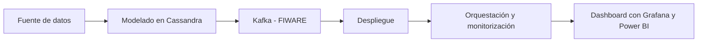

# Proyecto 3 - Smart City con FIWARE

## Descripción y objetivo

El objetivo es simular una ciudad inteligente (*Smart City*) con la plataforma **FIWARE**, integrando sensores virtuales para la captura, almacenamiento y **visualización de datos en tiempo real**, replicando un entorno urbano digitalizado analizable con herramientas de inteligencia de negocio.

## Arquitectura

Usaremos una arquitectura de **streaming**, con una arquitectura **IoT** basada en **FIWARE** que cubre ingestión, procesamiento y persistencia:
- Persistencia temporal: **QuantumLeap**
- Persistencia histórica: **CrateDB**

Tecnologías usadas:
- QuantumLeap
- CrateDB
- Kafka
- IoT
- Orion Context Broker
- Grafana 
- Power BI
- Cassandra

## Fuente de datos

Datos provenientes de tres tipos de sensores virtuales simulados:
- Temperatura y humedad
- CO2
- Calidad del Agua

| Sensor | Magnitudes |
| --- | --- |
| Temperatura y Humedad | Temperatura ambiente, humedad relativa|
| CO2 | Concentración de CO2 |
| Calidad del Agua | pH, temperatura, cloro |

| Fuente | URL / Origen | Formato | Frecuencia actualización | Licencia | Última ingesta |
| --- | --- | --- | --- | --- | --- |
| Sensor [Temperatura y Humedad, CO2, Calidad del agua] | [URL] | [Formato] | [Frecuencia] | [Licencia] | [Fecha] |

>[!NOTE]
La tabla de arriba no es definitivo, se irá actualizando a medida que avance el proyecto.

## Estructura del repositorio

Estas son las carpetas del repositorio:

| Carpeta | Contenido |
| --- | --- |
| dashboard/ | [dashboard] |
| etl | [etl] |
| ingesta | [ingesta] |

## Como desplegar el entorno

Con el **.env.example** que nos descargaremos, lo copiamos al que utiliza el repositorio.
`cp .env.example .env`

Levantamos los contenedores en modo *detached* con:
`docker compose up -d`

Para mirar que contenedores tenemos:
`docker compose ps`

Para parar el contenedor con:
>[!WARNING]
Perderemos los datos que no estén guardados en volumenes persistidos

`docker compose down`

## Bitácora de prácticas

> Cumplimentar al finalizar la práctica

### Bloque 0 - Entorno

- Objetivo: [ ]
- Pasos realizados: [ ]
- Problemas encontrados y solución: [ ]
- Resultado: [capturas, enlaces]

<!--
### Bloque 1 - Ingesta batch

- Objetivo: [ ]
- Pasos realizados: [ ]
- Problemas encontrados y solución: [ ]
- Resultado: [ ]
-->

### Bloque 2 - Bases de datos NoSQL

- Objetivo: [ ]
- Pasos realizados: [ ]
- Problemas encontrados y solución: [ ]
- Resultado: [ ]

<!--
### Bloque 3 - Data Lake

- Objetivo: [ ]
- Pasos realizados: [ ]
- Problemas encontrados y solución: [ ]
- Resultado: [ ]
-->

<!--
### Bloque 4 - Procesamiento con Spark

- Objetivo: [ ]
- Pasos realizados: [ ]
- Problemas encontrados y solución: [ ]
- Resultado: [ ]
-->

### Bloque 5 - Streaming con Kafka

- Objetivo: [ ]
- Pasos realizados: [ ]
- Problemas encontrados y solución: [ ]
- Resultado: [ ]

### Bloque 6 - FIWARE e IoT

- Objetivo: [ ]
- Pasos realizados: [ ]
- Problemas encontrados y solución: [ ]
- Resultado: [ ]

### Bloque 7 - Orquestación, calidad y gobierno

- Objetivo: [ ]
- Pasos realizados: [ ]
- Problemas encontrados y solución: [ ]
- Resultado: [ ]

| Nombre | Ubicación | Descripción | Esquema | Frecuencia | Responsable | Sensibilidad |
| --- | --- | --- | --- | --- | --- | --- |
| [tabla] | [ruta / colección] | [] | [] | [] | [] | [baja / media / alta] |

### Bloque 8 - Visualización

- Objetivo: [ ]
- Pasos realizados: [ ]
- Problemas encontrados y solución: [ ]
- Resultado: [ ]

<!--
### Bloque 9 - Inteligencia Artificial

- Objetivo: [ ]
- Pasos realizados: [ ]
- Problemas encontrados y solución: [ ]
- Resultado: [tabla de métricas]
-->

<!--
### Bloque 10 - Nube

- Objetivo: [ ]
- Pasos realizados: [ ]
- Problemas encontrados y solución: [ ]
- Resultado: [ ]
-->

### Decisiones técnicas

Las 2–3 decisiones de diseño más importantes, con la alternativa descartada. Te servirán para la defensa (Bloque 11, apartado 3).

| Decisión | Alternativa descartada | Motivo |
| --- | --- | --- |
| [] | [] | [] |

### Incidencias resueltas

| Problema | Causa | Solución |
| --- | --- | --- |
| [] | [] | [] |

## Resultado final

> Capturas del dashboard y del modelo, y enlace al vídeo o a la demo si la hay.