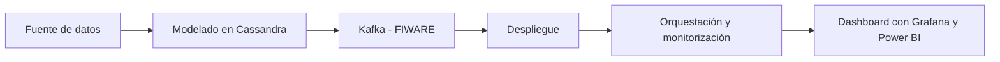
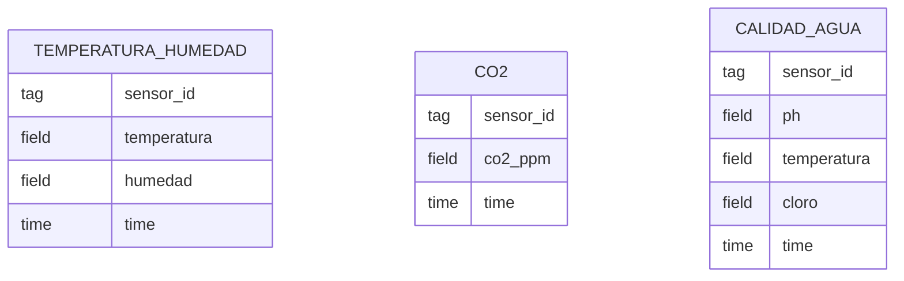
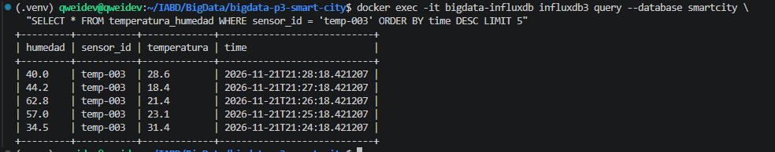
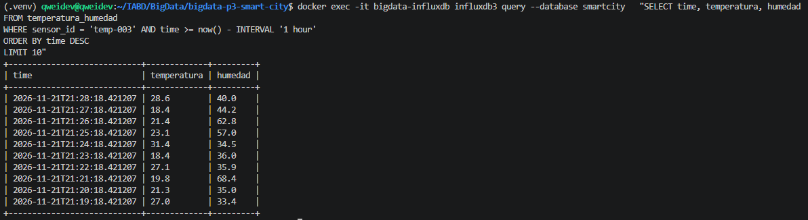
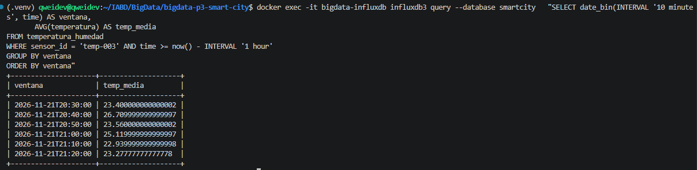
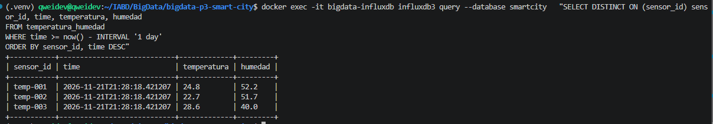
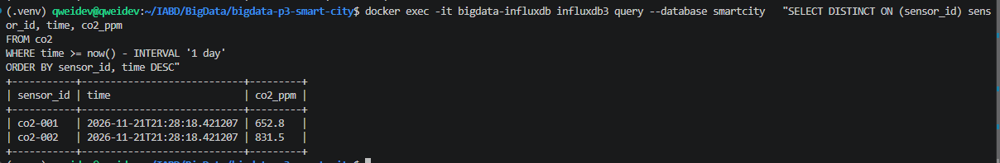
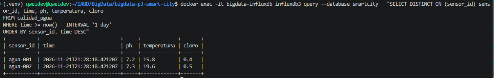

# Proyecto 3 - Smart City con FIWARE

## Descripción y objetivo

El objetivo es simular una ciudad inteligente (*Smart City*) con la plataforma **FIWARE**, integrando sensores virtuales para la captura, almacenamiento y **visualización de datos en tiempo real**, replicando un entorno urbano digitalizado analizable con herramientas de inteligencia de negocio.

## Arquitectura

Usaremos una arquitectura de **streaming**, con una arquitectura **IoT** basada en **FIWARE** que cubre ingestión, procesamiento y persistencia:
- Persistencia temporal: **QuantumLeap**
- Persistencia histórica: **CrateDB**

Tecnologías usadas:
- QuantumLeap
- CrateDB
- Kafka
- IoT
- Orion Context Broker
- Grafana 
- Power BI
- Cassandra

## Fuente de datos

Datos provenientes de tres tipos de sensores virtuales simulados:
- Temperatura y humedad
- CO2
- Calidad del Agua

| Sensor | Magnitudes |
| --- | --- |
| Temperatura y Humedad | Temperatura ambiente, humedad relativa|
| CO2 | Concentración de CO2 |
| Calidad del Agua | pH, temperatura, cloro |

| Fuente | URL / Origen | Formato | Frecuencia actualización | Licencia | Última ingesta |
| --- | --- | --- | --- | --- | --- |
| Sensor [Temperatura y Humedad, CO2, Calidad del agua] | Simulados con **simular_sensores.py** | Puntos de InfluxDB | Una lectura por minuto | Sin licencia | 21/11/2026 |

>[!NOTE]
La tabla de arriba no es definitivo, se irá actualizando a medida que avance el proyecto.

## Estructura del repositorio

Estas son las carpetas del repositorio:

| Carpeta | Contenido |
| --- | --- |
| dashboard/ | [dashboard] |
| etl | [etl] |
| ingesta | [ingesta] |
| simulacion | Script que simula los sensores y los carga en InfluxDB |
| docs | Capturas de las prácticas |

## Como desplegar el entorno

Con el **.env.example** que nos descargaremos, lo copiamos al que utiliza el repositorio.
`cp .env.example .env`

Levantamos los contenedores en modo *detached* con:
`docker compose up -d`

Creamos la base de datos de InfluxDB con:
`docker exec -it bigdata-influxdb influxdb3 create database smartcity`

Para mirar que contenedores tenemos:
`docker compose ps`

Para parar el contenedor con:
>[!WARNING]
Perderemos los datos que no estén guardados en volumenes persistidos

`docker compose down`

## Como simular los sensores

Instalamos las dependencias con:
`pip install -r requirements.txt`

Ejecutas el siguiente comando desde la raíz del proyecto:
`python simulacion/simular_sensores.py`

Escribe en InfluxDB una hora de lecturas, una por minuto, de todos los sensores.

Para consultar los datos:
`docker exec -it bigdata-influxdb influxdb3 query --database smartcity "SELECT * FROM co2 LIMIT 5"`

## Bitácora de prácticas

> Cumplimentar al finalizar la práctica

### Bloque 0 - Entorno

- Objetivo: Crear la estructura básica del proyecto
- Pasos realizados:
    1. Crear el repositorio y subirlo a GitHub
    2. Crear las carpetas ingesta, etl y dashboard
    3. Crear el .gitignore para no subir el .env
    4. Crear el README.md con la descripción, la arquitectura y la estructura del repositorio
- Problemas encontrados y solución: Ningún problema encontrado
- Resultado: El [repositorio](https://github.com/QiweiLiuYang/bigdata-p3-smart-city) con la estructura inicial

<!--
### Bloque 1 - Ingesta batch

- Objetivo: [ ]
- Pasos realizados: [ ]
- Problemas encontrados y solución: [ ]
- Resultado: [ ]
-->

### Bloque 2 - Bases de datos NoSQL

- Objetivo: Simular las lecturas de los sensores y cargarlas en **InfluxDB**
- Pasos realizados:
    1. Añadir **influxdb** al docker-compose.yml y crear la base de datos smartcity
    2. Diseñar un measurement por tipo de sensor con sus tags y fields
    3. Crear **simular_sensores.py** que simula una hora de lecturas de cada sensor y las escribe en lote
    4. Cargar los 420 puntos en InfluxDB
    5. Comprobar las lecturas con SQL (Q1, Q2 y Q3)
- Problemas encontrados y solución: Sin problemas
- Resultado: en [Verificación de la carga](#verificación-de-la-carga)

#### Modelo de datos

- **sensor_id** es tag porque tiene pocos valores y es por lo que filtramos y agrupamos
- Las medidas son fields. Si fueran tags cada valor nuevo crearía una serie y se dispararía la cardinalidad
- Un measurement por tipo de sensor para no mezclar grados, ppm y pH en el mismo campo
- Varios sensores por tipo (temp-001 a temp-003, co2-001, co2-002, agua-001 y agua-002) para que Q3 tenga sentido

#### Verificación de la carga

1. Lecturas de un sensor de temperatura de la más nueva a la más antigua

2. Q1, últimas lecturas de temp-003 en la última hora. Es el valor actual del dashboard

3. Q2, media de temperatura cada 10 minutos. Es la gráfica de tendencia. Uso la última hora en vez del rango de fechas fijo de la teoría porque los datos son de hoy y con esa fecha no devolvería nada

4. Q3, última lectura de cada sensor. Sale una fila por sensor en los tres tipos, así que hay lecturas de todos

<!--
### Bloque 3 - Data Lake

- Objetivo: [ ]
- Pasos realizados: [ ]
- Problemas encontrados y solución: [ ]
- Resultado: [ ]
-->

<!--
### Bloque 4 - Procesamiento con Spark

- Objetivo: [ ]
- Pasos realizados: [ ]
- Problemas encontrados y solución: [ ]
- Resultado: [ ]
-->

### Bloque 5 - Streaming con Kafka

- Objetivo: [ ]
- Pasos realizados: [ ]
- Problemas encontrados y solución: [ ]
- Resultado: [ ]

### Bloque 6 - FIWARE e IoT

- Objetivo: [ ]
- Pasos realizados: [ ]
- Problemas encontrados y solución: [ ]
- Resultado: [ ]

### Bloque 7 - Orquestación, calidad y gobierno

- Objetivo: [ ]
- Pasos realizados: [ ]
- Problemas encontrados y solución: [ ]
- Resultado: [ ]

| Nombre | Ubicación | Descripción | Esquema | Frecuencia | Responsable | Sensibilidad |
| --- | --- | --- | --- | --- | --- | --- |
| [tabla] | [ruta / colección] | [] | [] | [] | [] | [baja / media / alta] |

### Bloque 8 - Visualización

- Objetivo: [ ]
- Pasos realizados: [ ]
- Problemas encontrados y solución: [ ]
- Resultado: [ ]

<!--
### Bloque 9 - Inteligencia Artificial

- Objetivo: [ ]
- Pasos realizados: [ ]
- Problemas encontrados y solución: [ ]
- Resultado: [tabla de métricas]
-->

<!--
### Bloque 10 - Nube

- Objetivo: [ ]
- Pasos realizados: [ ]
- Problemas encontrados y solución: [ ]
- Resultado: [ ]
-->

### Decisiones técnicas

Las 2–3 decisiones de diseño más importantes, con la alternativa descartada. Te servirán para la defensa (Bloque 11, apartado 3).

| Decisión | Alternativa descartada | Motivo |
| --- | --- | --- |
| Un measurement por tipo de sensor | Un measurement genérico con un tag tipo_sensor y un field valor | No se mezclan grados, ppm y pH en el mismo campo y las consultas son más simples |
| sensor_id como tag y las medidas como fields | Guardar las medidas como tags | Cada valor nuevo crearía una serie y se dispararía la cardinalidad |

### Incidencias resueltas

| Problema | Causa | Solución |
| --- | --- | --- |

## Resultado final

> Capturas del dashboard y del modelo, y enlace al vídeo o a la demo si la hay.